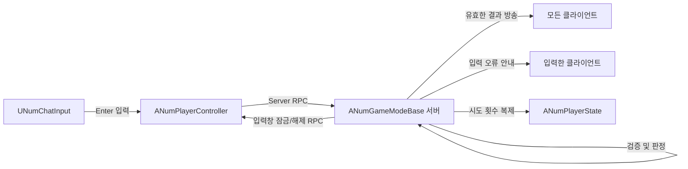

# NumberBaseballGame

Unreal Engine C++로 만든 멀티플레이 숫자 야구 게임입니다. 서버가 정답과 라운드를 관리하고, 플레이어의 입력을 검증한 뒤 결과를 클라이언트에 전달합니다.

이 문서는 코드가 어떤 순서로 동작하는지, 그리고 Unreal Engine 자료구조를 각 기능에 왜 사용하는지 설명합니다.

## 게임 규칙

- 정답과 입력은 `1`~`9` 중 중복 없이 고른 세 자리 숫자입니다.
- 숫자와 위치가 모두 맞으면 스트라이크, 숫자만 맞고 위치가 다르면 볼, 일치하는 숫자가 없으면 `OUT`입니다.
- 플레이어마다 라운드당 최대 세 번 추측할 수 있습니다.
- 입력 형식이 잘못됐거나 숫자가 반복되거나, 라운드에서 이미 제출한 추측이면 즉시 기회를 사용하지 않습니다. 다만 제한 시간은 계속 흐르므로 유효한 입력 없이 시간이 끝나면 기회를 한 번 사용합니다.
- 잘못된 입력 안내는 입력한 플레이어에게만 보입니다. 유효한 추측 결과와 기회 소진 안내는 모든 플레이어에게 보입니다.
- 기회를 모두 사용한 플레이어는 입력창이 잠기고 서버도 입력을 거부합니다. 새 라운드가 시작되면 다시 입력할 수 있습니다.
- 정답은 화면에 표시하지 않고 서버의 `Warning` 로그에만 출력합니다.

## 코드 구성

| 클래스 | 파일 | 책임 |
|---|---|---|
| `ANumGameModeBase` | `Source/NumberBaseballGame/Game/NumGameModeBase.h/.cpp` | 서버의 정답, 입력 검증, 판정, 기회, 턴 타이머와 라운드 관리 |
| `ANumGameStateBase` | `Source/NumberBaseballGame/Game/NumGameStateBase.h/.cpp` | 남은 턴 시간·현재 플레이어·진행 상태 복제, 접속 안내 멀티캐스트 |
| `ANumPlayerController` | `Source/NumberBaseballGame/Player/NumPlayerController.h/.cpp` | 클라이언트 입력을 서버에 보내고, 결과와 입력창 상태를 클라이언트에 전달 |
| `ANumPlayerState` | `Source/NumberBaseballGame/Player/NumPlayerState.h/.cpp` | 플레이어 이름과 현재/최대 시도 횟수 저장 및 복제 |
| `UNumChatInput` | `Source/NumberBaseballGame/UI/NumChatInput.h/.cpp` | UMG 입력창의 Enter 이벤트 처리, 입력창 잠금/해제 |
| `ANumPawn` | `Source/NumberBaseballGame/Player/NumPawn.h/.cpp` | 플레이어 Pawn |

| `UNumTimeWidget` | `Source/NumberBaseballGame/UI/NumTimeWidget.h/.cpp` | 남은 턴 시간, 현재 차례와 내 남은 기회 표시 |

## 게임 흐름



1. `UNumChatInput`이 Enter를 감지해 `SetChatMessageString`을 호출합니다.
2. `ANumPlayerController`가 `ServerRPCPrintChatMessageString`으로 입력을 서버에 보냅니다.
3. 서버의 `ANumGameModeBase::PrintChatMessageString`이 기회 소진 여부, 현재 턴의 입력 권한, 입력 형식, 입력 안의 숫자 중복, 라운드 내 추측 중복 순서로 검사합니다.
4. 검사를 통과한 입력만 `SubmittedGuesses`에 기록하고 시도 횟수를 올립니다.
5. 서버가 스트라이크/볼을 계산해 모든 클라이언트에 알립니다.
6. 정답이면 라운드를 초기화하고, 오답이면 다음 플레이어에게 턴을 넘깁니다.
7. 유효한 입력 없이 시간이 끝나면 기회를 한 번 사용하고 다음 턴으로 넘어갑니다. 모든 플레이어가 기회를 소진하면 무승부로 라운드를 초기화합니다.

## Unreal Engine 자료구조

| 자료구조/타입 | 코드에서 쓰는 곳 | 선택 이유 |
|---|---|---|
| `FString` | 정답, 입력, 결과 메시지 | 숫자 순서와 각 자리 문자를 그대로 다루기 좋습니다. |
| `TArray<int32>` | 정답 생성 후보 숫자 목록 | 후보를 순회하고, 뽑은 숫자를 `RemoveAt`으로 제거할 수 있습니다. |
| `TSet<FString>` | `SubmittedGuesses` | 라운드에서 같은 추측이 이미 나왔는지 `Contains`로 확인합니다. 새 라운드에서는 `Reset`으로 비웁니다. |
| `TArray<TObjectPtr<ANumPlayerController>>` | `AllPlayerControllers` | 접속 플레이어를 모아 알림을 보내거나 라운드를 초기화할 때 순회합니다. |
| `TObjectPtr<T>` | 위젯 인스턴스 참조 | Unreal UObject를 참조합니다. 위젯 인스턴스는 `UPROPERTY`와 함께 선언되어 엔진이 추적할 수 있습니다. |
| `TSubclassOf<T>` | 위젯 클래스 설정 | 에디터에서 지정하는 클래스가 예상한 부모 클래스의 하위 클래스인지 제한합니다. |

`TArray`는 순회할 목록에, `TSet`은 중복 여부를 확인할 데이터에 사용합니다. 정답 후보와 플레이어 목록은 배열로 관리하고, 라운드별 제출 기록은 집합으로 관리합니다.

## 단계별 구현

아래 1~4의 코드는 핵심 원리를 설명하기 위해 변수명과 일부 내용을 간략화한 예시입니다. 실제 함수 선언과 전체 처리는 각 소스 파일을 기준으로 확인하세요.

### 1. 정답 만들기: `TArray`와 `FString`

`GenerateSecretNumber`는 `1`~`9` 후보를 `TArray<int32>`에 넣고, 무작위로 하나를 골라 결과 문자열에 추가합니다. 고른 숫자는 배열에서 제거하므로 정답 안에 같은 숫자가 다시 들어가지 않습니다.

```cpp
FString ANumGameModeBase::GenerateSecretNumber()
{
	TArray<int32> CandidateDigits;
	for (int32 Digit = 1; Digit <= 9; ++Digit)
	{
		CandidateDigits.Add(Digit);
	}

	FString SecretNumber;
	for (int32 Place = 0; Place < 3; ++Place)
	{
		const int32 RandomIndex = FMath::RandRange(0, CandidateDigits.Num() - 1);
		SecretNumber.Append(FString::FromInt(CandidateDigits[RandomIndex]));
		CandidateDigits.RemoveAt(RandomIndex);
	}

	return SecretNumber;
}
```

정답은 `ANumGameModeBase`가 서버에서만 보관합니다. `BeginPlay`와 `ResetGame`에서 정답을 만들고 `UE_LOG(LogTemp, Warning, ...)`으로 서버 로그에 출력합니다. 정답을 클라이언트에 복제하거나 게임 화면에 보여주지는 않습니다.

### 2. 입력 유효성 검사

`IsGuessNumberString`은 입력이 세 자리인지, 각 문자가 `1`~`9`인지 확인합니다. 입력 안의 숫자 중복은 호출부에서 따로 검사해 구체적인 안내를 보냅니다.

```cpp
bool ANumGameModeBase::IsGuessNumberString(const FString& Guess)
{
	if (Guess.Len() != 3)
	{
		return false;
	}

	for (TCHAR Digit : Guess)
	{
		if (Digit < TEXT('1') || Digit > TEXT('9'))
		{
			return false;
		}
	}

	return true;
}
```

### 3. 제출 중복 확인: `TSet<FString>`

같은 숫자 조합을 라운드에서 다시 사용하지 못하게 `SubmittedGuesses`에 유효한 추측을 저장합니다. 집합에 이미 있으면 시도 횟수를 올리지 않고, 입력한 플레이어에게만 메시지를 보냅니다.

```cpp
if (SubmittedGuesses.Contains(Guess))
{
	const FString Message = PlayerState->GetPlayerInfoString()
		+ TEXT(": 이미 제출된 숫자입니다. 다시 입력하세요");
	InChattingPlayerController->ClientRPCPrintChatMessageString(Message);
	return;
}

SubmittedGuesses.Add(Guess);
IncreaseGuessCount(InChattingPlayerController);
```

입력 안에서 숫자가 반복되는 `112`와, 누군가 이미 제출한 `369`는 서로 다른 검사입니다. `112`는 입력의 세 자리를 서로 비교하고, 이미 제출된 `369`는 `TSet<FString>`에서 전체 문자열을 조회합니다.

### 4. 스트라이크와 볼 계산

입력 유효성 검사를 통과한 추측만 `JudgeResult`로 전달합니다. 같은 위치의 숫자가 같으면 스트라이크로 세고, 위치는 다르지만 정답에 포함된 숫자면 볼로 셉니다.

```cpp
FString ANumGameModeBase::JudgeResult(
	const FString& Secret,
	const FString& Guess)
{
	int32 Strikes = 0;
	int32 Balls = 0;

	for (int32 Place = 0; Place < 3; ++Place)
	{
		if (Secret[Place] == Guess[Place])
		{
			++Strikes;
		}
		else
		{
			const FString GuessDigit = FString::Printf(TEXT("%c"), Guess[Place]);
			if (Secret.Contains(GuessDigit))
			{
				++Balls;
			}
		}
	}

	if (Strikes == 0 && Balls == 0)
	{
		return TEXT("OUT");
	}

	return FString::Printf(TEXT("%dS%dB"), Strikes, Balls);
}
```

### 5. 기회와 라운드 관리

- 기회를 모두 썼는지 입력 형식 검사보다 먼저 확인합니다. 이후 입력은 거부하고 전체에 `기회를 모두 사용했습니다.`를 알립니다.
- 마지막 기회를 틀리면 `ClientRPCSetChatInputEnabled(false)`로 해당 플레이어의 입력창을 잠급니다. 서버도 시도 횟수를 확인하므로 UI를 우회해도 입력은 처리되지 않습니다.
- 3스트라이크면 해당 플레이어가 승리합니다. 모든 플레이어가 최대 횟수에 도달하면 무승부입니다.
- `ResetGame`은 새 정답을 만들고 `SubmittedGuesses.Reset()`으로 제출 기록을 비웁니다. 플레이어별 시도 횟수를 0으로 되돌리고 입력창 잠금을 해제합니다.

## 네트워크 역할

- **서버 전용:** `ANumGameModeBase`의 정답과 `SubmittedGuesses`는 서버에서만 관리합니다.
- **복제되는 플레이어 상태:** `ANumPlayerState`의 이름과 현재/최대 횟수는 `DOREPLIFETIME`으로 클라이언트에 복제됩니다.
- **클라이언트에서 서버로:** `ServerRPCPrintChatMessageString`으로 추측을 전달합니다.
- **서버에서 개인에게:** 잘못된 입력 안내와 입력창 상태 변경은 해당 플레이어의 Client RPC로 전달합니다.
- **서버에서 전체로:** 유효한 추측 결과와 기회 소진 안내는 각 플레이어 컨트롤러의 Client RPC를 통해 방송합니다.

## 추가 구현: 턴 제어와 통합 시간 위젯

### 1. 역할을 나눈 이유

서버가 게임 규칙을 처리하고, GameState가 공개 상태를 전달하며, 위젯은 전달받은 값을 화면에 표시합니다.

```text
ANumGameModeBase (서버)
  ├─ 다음 플레이어 선택 / 입력 허용 여부 검사
  ├─ 남은 시간 감소 / 시간 초과 시 기회 사용
  └─ ANumGameStateBase 값 변경
       └─ 네트워크 복제 → 각 클라이언트의 UNumTimeWidget
                            ├─ RemainingTurnTimeText
                            └─ TurnCheckText
```

- **GameMode:** 정답과 판정, 턴 전환을 담당합니다.
- **GameState:** 모든 플레이어에게 알려줄 턴 상태를 저장합니다.
- **PlayerState:** 플레이어별 이름과 사용한 기회 수를 저장합니다.
- **PlayerController:** 입력과 안내 메시지를 RPC로 전달합니다.
- **NumTimeWidget:** 시간과 턴 정보를 읽어 표시합니다.

`NumTurnCheck`의 표시 기능은 `NumTimeWidget`에 통합했습니다. 전체 플레이 시간을 누적해서 보여주던 기능은 제거했으며, 현재 표시하는 시간은 **현재 턴의 남은 시간**입니다.

### 2. 턴 관리에 사용하는 자료구조와 타입

| 자료구조 / 타입 | 실제 변수 | 사용 이유 |
|---|---|---|
| `TArray<TObjectPtr<ANumPlayerController>>` | `AllPlayerControllers` | 접속 순서를 유지하고 인덱스로 다음 플레이어를 선택합니다. |
| `TSet<FString>` | `SubmittedGuesses` | 이번 라운드에 같은 세 자리 문자열이 제출됐는지 확인합니다. |
| `TObjectPtr<ANumPlayerState>` | `CurrentTurnPlayerState` | 현재 차례인 플레이어의 상태 객체를 가리킵니다. |
| `TObjectPtr<UTextBlock>` | `TurnCheckText`, `RemainingTurnTimeText` | 위젯의 텍스트 요소를 참조합니다. `UPROPERTY`와 함께 사용합니다. |
| `FTimerHandle` | `TurnClockHandle` | 엔진 TimerManager에 등록한 반복 타이머를 식별합니다. |
| `FString` / `FText` | 안내 문자열 / 화면 텍스트 | `FString`으로 내용을 조합하고 `FText`로 변환하여 텍스트 위젯에 전달합니다. |
| `int32` / `bool` | 인덱스, 남은 초 / 제출·진행 여부 | 숫자 상태와 참·거짓 상태를 저장합니다. |

`TArray`와 `TSet`은 컨테이너이고, `TObjectPtr`는 객체 참조 타입입니다. `FTimerHandle`은 시간 자체를 저장하는 변수가 아니라 타이머 식별자입니다. `bool`은 C++ 기본 타입입니다.

### 3. 서버에서 타이머 시작하기

`BeginPlay`에서 다음 코드를 실행합니다.

```cpp
// 서버에서 1초 간격으로 UpdateTurnClock을 반복 호출합니다.
GetWorldTimerManager().SetTimer(TurnClockHandle, this,
    &ANumGameModeBase::UpdateTurnClock, 1.0f, true);
StartTurnSystem();
```

`StartTurnSystem`은 이미 턴이 진행 중이거나 플레이어가 없으면 종료합니다. 시작할 수 있으면 인덱스를 `INDEX_NONE`으로 초기화하고 `StartNextTurn`을 호출합니다.

`StartNextTurn`은 배열을 순서대로 확인하며 기회가 남은 플레이어를 선택합니다. 선택한 플레이어를 `CurrentTurnPlayerState`에 저장하고 남은 시간을 `TurnDurationSeconds`로 설정합니다. 기본 설정값은 15초입니다.

```cpp
// 마지막 플레이어 다음에는 배열의 첫 플레이어로 돌아갑니다.
CurrentTurnPlayerIndex = (CurrentTurnPlayerIndex + 1) % AllPlayerControllers.Num();
```

이 코드는 배열 길이만큼 반복하는 루프 안에서 실행됩니다. 배열이 비어 있으면 루프에 들어가지 않습니다. 접속이 끊기면 `Logout`에서 해당 항목을 제거하고 인덱스를 조정합니다.

### 4. 시간 동기화: 서버 값 복제하기

GameState에는 아래 세 가지 상태가 `UPROPERTY(Replicated, ...)`로 선언되어 있습니다.

```cpp
int32 RemainingTurnSeconds = 0;
TObjectPtr<ANumPlayerState> CurrentTurnPlayerState = nullptr;
bool bTurnInProgress = false;
```

위 코드는 변수만 발췌한 것입니다. 실제 복제를 위해서는 헤더의 `UPROPERTY(Replicated, ...)`와 다음 등록 코드가 함께 필요합니다.

```cpp
DOREPLIFETIME(ANumGameStateBase, RemainingTurnSeconds);
DOREPLIFETIME(ANumGameStateBase, CurrentTurnPlayerState);
DOREPLIFETIME(ANumGameStateBase, bTurnInProgress);
```

서버의 `UpdateTurnClock`이 남은 초를 줄이고, 변경된 상태가 클라이언트로 복제됩니다. 위젯은 자체적으로 시간을 차감하지 않고 복제받은 값을 사용합니다. 따라서 모두 서버의 같은 상태를 기준으로 표시하지만, 네트워크 지연에 따라 화면에 반영되는 시점은 조금 다를 수 있습니다.

현재 타이머는 게임 시작 때 등록한 1초 주기를 계속 사용합니다. 턴이 바뀔 때 타이머 주기 자체를 다시 시작하지 않으므로 새 턴의 첫 감소까지는 1초보다 짧을 수 있습니다.

### 5. 입력 허용과 기회 사용

`CanSubmitDuringTurn`은 아래 조건을 모두 만족할 때만 입력을 허용합니다.

1. GameState와 입력한 플레이어의 PlayerState가 유효합니다.
2. 턴이 진행 중이고 남은 시간이 0초보다 큽니다.
3. 입력한 플레이어가 현재 차례입니다.
4. 이번 턴에 유효한 추측을 아직 제출하지 않았습니다.
5. 사용 가능한 기회가 남아 있습니다.

그 후에 세 자리 형식과 중복을 검사합니다. `bSubmittedThisTurn`은 **이번 턴의 유효한 제출 여부**입니다. 잘못된 입력을 했다는 이유만으로 `true`가 되지 않습니다.

| 상황 | 기회 처리 | 턴 처리 |
|---|---|---|
| 유효한 추측 제출 | 사용 횟수 1 증가 | 정답이면 라운드 초기화, 오답이면 다음 턴 |
| 잘못된 형식 / 입력 내부 중복 / 이미 제출된 추측 | 즉시 증가하지 않음 | 현재 턴과 제한 시간 유지 |
| 유효한 제출 없이 시간 초과 | 사용 횟수 1 증가 | 다음 턴 |
| 자기 차례가 아닌 입력 | 증가하지 않음 | 서버에서 거부 |
| 기회 소진 후 입력 | 추가 증가하지 않음 | 입력창 잠금 및 서버 거부 |

유효한 제출에서는 `IncreaseGuessCount`를 호출하고 `bSubmittedThisTurn`을 `true`로 설정합니다. `FinishCurrentTurn`은 이 값을 확인하므로 이미 제출한 플레이어의 기회를 다시 차감하지 않습니다.

`CurrentGuessCount`는 **사용한 횟수**입니다. 기회를 한 번 사용하는 코드는 이 값을 증가시킵니다. 화면에 표시할 남은 기회는 다음처럼 계산합니다.

```cpp
const int32 RemainingTurns = FMath::Max(
    0, NumPS->MaxGuessCount - NumPS->CurrentGuessCount);
```

현재 차례가 아니거나 시간이 끝난 입력은 서버가 거부합니다. 입력창 잠금은 기회를 모두 사용했을 때 적용하며, 다음 라운드에 해제합니다.

### 6. NumTimeWidget에서 화면 갱신하기

`WBP_Time`은 `UNumTimeWidget`을 부모 클래스로 사용합니다. 두 텍스트 위젯 이름은 C++의 `BindWidget` 멤버명과 맞아야 합니다.

| 텍스트 위젯 | 표시 내용 | 예시 |
|---|---|---|
| `RemainingTurnTimeText` | 현재 턴의 남은 시간 | `남은 시간 00:12` |
| `TurnCheckText` | 현재 차례와 내 남은 기회 | `내 턴 / 내 남은 기회 2회` |

`NativeConstruct`에서 처음 표시하고, `NativeTick`에서 `RefreshTimeText`를 호출해 갱신합니다. 여기서 `BindWidget`은 텍스트 객체를 연결하는 기능입니다. 화면의 내용은 C++의 `SetText` 호출로 변경합니다.

`RefreshTimeText`의 순서는 다음과 같습니다.

1. GameState에서 남은 시간과 현재 차례를 읽습니다.
2. 위젯 소유자의 PlayerState를 가져옵니다.
3. 남은 초를 분과 초로 나누어 표시합니다.
4. 현재 차례와 소유자가 같으면 `내 턴`, 다르면 플레이어 이름을 표시합니다.
5. 소유자의 최대 횟수에서 사용 횟수를 빼서 내 남은 기회를 표시합니다.

아직 필요한 상태가 없으면 대기 문구를 출력합니다. `StopTurnSystem`은 턴 상태를 초기화하며, 반복 타이머 자체를 해제하지는 않습니다. 턴이 멈춘 동안 `UpdateTurnClock`은 남은 시간을 줄이지 않습니다.
